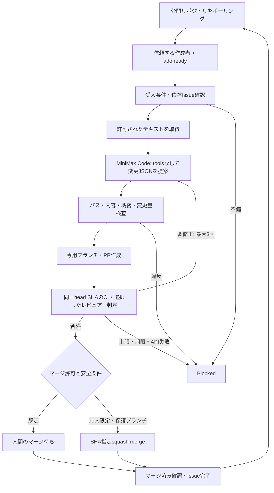

# Autonomous Dev Orchestrator (ADO)

Mac mini M2 / 16GBの1台で動かす、複数GitHubプロジェクト用の自律開発オーケストレーターMVPです。Python 3.11以上・標準ライブラリのみ。初期設定は **dry-run、自動マージ無効、1ジョブ**。n8n、追加AI API、クラウドDB、Webhookサーバーは不要です。

**MiniMax Code 0.6.12のToken Planログインと、macOS sandbox内での単発変更生成を実環境で確認済みです。** AIによる連続修正（実PRの修正ループ）とCodeRabbitの承認も実サービスで確認済みです。自動マージの実サービス受入は別途必要です。利用するCLIバージョンで受入確認を行ってください。`doctor`でCLI互換性を診断できますが、利用環境ごとのログイン・モデル呼出しは別途確認してください。課金APIへの代替経路はありません。

## フロー



処理状態はSQLite、監査イベントはマスキングしたJSONLに記録します。対象リポジトリのclone・ローカルテスト・ビルドは行わず、Git Data APIで変更を作成します。対象コードはGitHubの標準ホストRunnerで検証します。公開リポジトリのself-hosted Runnerは使用しません。

## すぐ試す

```sh
python3.12 -m venv .venv
.venv/bin/python -m pip install --no-deps -e .
cp examples/config.toml config.toml
.venv/bin/python -m ado --config config.toml doctor
.venv/bin/python -m ado --config config.toml run --once
.venv/bin/python -m unittest discover -v
.venv/bin/python -m ado --config config.toml status
```

`config.toml`のリポジトリ一覧を確認してください。サンプルはSMRI2170/animal-shadow-matchを**参照するだけ**で、設定ファイルを対象側に追加しません。dry-runはIssueの取得・仕様と依存関係の検査だけを実施し、モデル呼び出し・GitHub書き込み・ライブジョブの予約を行いません。既存`gh auth login`による公開リポジトリ読み取りが使えます。

ライブ運用の手順は[セットアップ](docs/setup.md)、常駐方法は[launchd](docs/launchd.md)、安全条件は[セキュリティ設計](docs/security.md)、動作確認と未実装事項は[検証結果](docs/verification.md)を参照してください。

用語集は[用語集](docs/glossary.md)、workerの状態ごとの意味と運用者の対応は[オペレーターランブック](docs/operator-runbook.md)を参照してください。

## フローを画面で見る

```sh
.venv/bin/python -m ado --config config.toml dashboard
```

http://127.0.0.1:8765/ でIssueごとの現在地、実装している内容、待機・停止理由、修正回数を確認できます。工程をクリックすると説明が開き、3秒ごとに更新します。「デモを見る」で表示例も確認できます。読み取り専用で、起動によるworker実行・GitHub書込みはありません。詳しくは[フロー監視画面](docs/dashboard.md)を参照してください。既定の8765が他のローカルアプリと衝突する場合は `--port` で別ポートを指定してください（例: `ado dashboard --port 8766`）。

## 実装範囲

| 機能 | MVPの状態 |
|---|---|
| 複数対象のTOML登録、Issue opt-in、仕様・依存チェック | 実装済み。単一リポジトリ内の`Depends-On: #12, #13`のみ |
| MiniMax実装・修正 | `mcode exec --mode lightweight`の変更JSONアダプター実装。0.6.12 Token Planで単発生成を検証済み。実PRの修正ループ（Issue #16 / #18、#24、#34、#39）も実サービスで検証済み |
| 分離 | toolsなし、環境変数を限定、macOS Seatbelt、対象cloneなし。危険コマンド実行経路なし |
| ブランチ・PR・CI・レビュー取得 | GitHub REST/GraphQL実装。全ページを上限付きで取得、欠落時は不合格 |
| 修正上限・冪等性・再起動 | 初回+最大3回。予算を呼び出し前に保存。publish意図・commitを永続化 |
| MiniMaxレビュー | 選択制（`review_provider = "minimax"`）。独立したツールなしCLI呼び出し、構造化判定、最新SHA・差分ダイジェストに紐づくSQLite記録。CodeRabbitは任意。実PRでの受入は済み（Issue #24 / #34 / #39） |
| 自動マージ | 既定OFF。MiniMax自己レビューによる自動マージは禁止。従来のCodeRabbit方式は条件付きで残す |
| Issue完了・次Issue | 実際のマージ済み状態を確認後に完了。Blockedは自動再試行しない |
| 可視化 | `ado dashboard`のローカルフロー画面、`ado status`、JSONL、PR。工程・作業内容・待機理由とworkerの稼働状態を表示。状態ごとの運用者対応は[オペレーターランブック](docs/operator-runbook.md) |
| GitHub Projects書込み、n8n、Codex自動呼出し | **未実装**。比較と拡張案は[設計判断](docs/architecture.md) |

`run --once`は1回の状態遷移です。通常の`run`は60秒間隔で継続します。CI/レビュー待ち・人間のマージ待ちも1つのアクティブジョブとして扱います。安全な小規模変更向けMVPであり、任意規模のFlutter/Unity開発を自律完遂するものではありません。

## コストの境界

MiniMaxは既存契約でログインした専用プロファイルを使います。OpenAI/MiniMaxの従量課金APIキーは受け付けず、枠超過・ログイン失敗はBlockedです。ただし、CLI側で選択したプロバイダーや契約内容は運用者による確認が必要で、本ツールがアカウントの請求額を保証する仕組みはありません。新規有料サービスへの登録や自動アップグレードはしません。

CI対象は公開リポジトリのみ、標準`ubuntu-latest`のみをサンプルで使用します。private repoと有料Runnerは対象外。旧設定のレビュー方式はCodeRabbitですが、新規導入用のサンプルではMiniMaxを選択しています。`review_provider = "minimax"`にすると、MiniMax Codeの既存契約にログインした専用プロファイルを使って別のツールなし呼び出しでレビューします。追加の従量課金APIへの切替はありませんが、契約の利用上限を超える可能性はあります。レビュー中の中断は再実行せずBlockedとし、自動マージは不可です。

## ライセンス

MIT。GitHub ActionsはSHAで固定しています。再利用時はレビュー済みのコミットSHAを指定してください。
